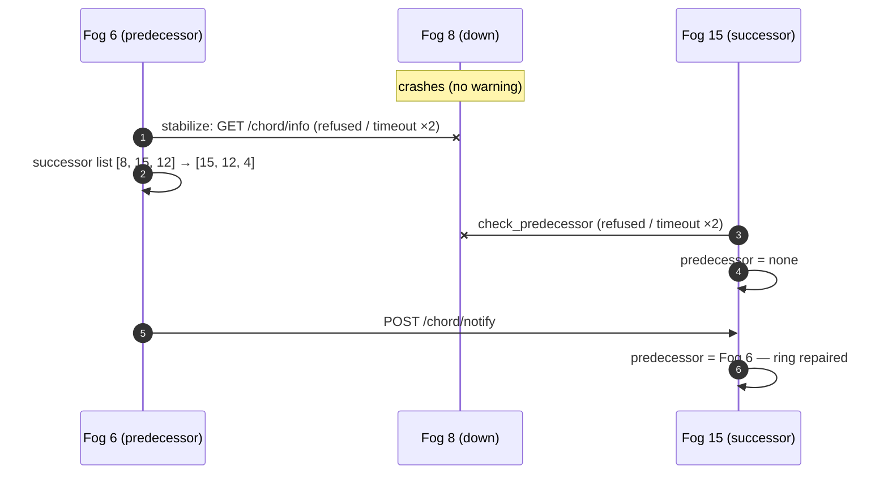

# HTF — Human Trail in the Fog

Rebuilding a person's digital trail through the Fog nodes of a smart city, with stateful
handover between Fog nodes, GS1 EPCIS 2.0 traceability events and a decentralized directory
(Chord ring) that stores pseudonyms only.

Undergraduate thesis (TCC) — Computer Science, UNISINOS (2026) · João Vítor Accorsi · Advisor: Dr. Rodrigo da Rosa Righi


<sub>Architecture of the prototype. Orange: control plane (handover and context migration between Fog
nodes). Blue: data plane (EPCIS documents sent to the cloud and queries). Dashed green: Chord ring
(OIDA) among the Fog nodes. Dashed grey: MQTT between each Edge and the Fog node serving it.
C1–C3 mark the three contributions.</sub>

**Contents:** [Overview](#overview) · [Architecture](#architecture) · [How it works](#how-it-works) ·
[APIs](#apis) · [How to run](#how-to-run) · [Containers and AWS](#containers-and-aws) ·
[Limitations](#limitations-of-the-prototype)

---

## Overview

A person carries a phone (the **Edge** device) across a city whose area is split among **Fog nodes**.
Each Fog node serves the devices in its area and records the person's **visit** there. When the
person moves to another area, the Fog node hands the person's state over to the next one
(**handover**), and each closed visit goes to the **cloud** as a standardized event. In the
cloud, an authorized user rebuilds the person's **trail** (the ordered visits of a day).


<sub>Motivating use case: a monitored person crosses the areas of several Fog nodes during the day;
each Fog node records a piece of the trail and the cloud joins them. The vital signs are part of the
motivation only; the prototype handles positions.</sub>


<sub>Centralized monitoring (before) and HTF (after): decisions near the person, context migration
between Fog nodes, a decentralized directory and a cloud that only sees pseudonyms.</sub>

The three contributions and where they live in the code:

| | Contribution | Implementation |
|---|---|---|
| **C1** | Stateful make-before-break handover between Fog nodes, decided by a synthetic RSRP smoothed by a Kalman filter, with hysteresis (HOM) and Time to Trigger (TTT) | `fog/.../HandoverDecision.java`, `Radio.java`, `Kalman.java`, `FogNode.java` |
| **C2** | Visits described as GS1 EPCIS 2.0 documents, with store-and-forward, and trails rebuilt in the cloud | `fog/.../Epcis.java`, `TmsClient.java`, `cloud/tms/` |
| **C3** | Decentralized directory (OIDA) on a fault-tolerant Chord ring, indexed by salted pseudonyms | `fog/.../ChordNode.java`, `FogCommunication.java` |

Human mobility comes from the **YJMob100K** dataset 2: anonymized trajectories of 25,000 users on a
grid of 200 × 200 cells of 500 m, in 30-minute timeslots, over 75 days. Each record of a user
becomes one ping of the Edge.

---

## Architecture

| Layer | Component | Language | Folder | Role |
|---|---|---|---|---|
| Edge | Edge device | Java | `edge/` | Replays one user/day of the dataset: computes the pseudonym, publishes one ping per timeslot over MQTT and switches broker when the Fog node says so |
| Fog | 16 Fog nodes | Java | `fog/` | Each node: embedded MQTT broker, HTTP API, Chord ring peer, handover logic and EPCIS adapter |
| Cloud | TMS — Trail Management Service | Java | `cloud/tms/` | Receives the EPCIS documents (`POST /capture`), stores them and answers trail queries |
| Cloud | CMP — Cloud Mobility Platform | Python (Streamlit) | `cloud/mobility-platform/` | Web interface: rebuilds a user's trail and shows who passed through a Fog node |
| — | Deployment | Docker, Terraform | `deploy/`, `docker-compose.yml` | Containers and the AWS environment (one EC2 instance per node) |

- **Edge → Fog: MQTT, with a broker in each Fog node.** The Edge connects to the broker of the Fog
  node serving it, like a phone to its base station, and switches broker on handover.
- **Fog ↔ Fog: direct (P2P) HTTP.** The nodes find each other and locate a user's context through
  the Chord ring; the context goes straight from one node to the other.
- **Fog → Cloud: HTTP `POST /capture`** with GS1 EPCIS 2.0 documents and store-and-forward.
- A **visit** is a user's stay in one Fog node's area (arrival, departure, cells, pings and how it
  ended: handover or end of day). A **trail** is the ordered list of visits of a day.

### The city on the cartesian plane


<sub>Left: the 200 × 200 cells split into 16 Fog areas of 50 × 50 cells (25 × 25 km); Fog N is at row
(N−1)/4 and column (N−1)%4 counted from the bottom-left, with MQTT broker on port 1900+N and HTTP
API on 9000+N. Fog 1 is the entry node of every Edge and the seed of the ring. Right: user 4005 on
day 20 near the Fog 2 | Fog 3 border; the hysteresis band keeps the user in the serving node, so
there is a single handover (13:30) instead of a back-and-forth.</sub>

### Inside a Fog node


<sub>Every Fog node is the same object with its own ports. All decisions run on a single logic
thread, so the state needs no locks; HTTP handlers only enqueue work or answer from local data.</sub>

### The Chord ring (OIDA)


<sub>The ring is not an extra node: each Fog node is a peer. It stores two kinds of records:
`fog:{id}` → address of a Fog node, and `h:{pseudonym}` → Fog node holding the user's context.</sub>

---

## How it works

### Data path and make-before-break handover


1. The Edge computes `h = HMAC-SHA256(salt, uid)` and enters through Fog 1, which redirects it to
   the Fog node that owns its cell.
2. On every ping, the serving node **A** runs the handover decision (below). While there is no
   handover, the ping is recorded in A's open visit.
3. When the decision picks node **B**, A finds B's address on the ring, sends it the user's
   context (`/handover/prepare`) and only then tells the Edge to connect to B's broker.
4. The Edge connects to B **before** leaving A (make). B activates the context, registers
   `h:{h} → B` on the ring and confirms to A (`/handover/commit`).
5. A closes its visit and sends it to the TMS as an EPCIS document (break). Pings that still reach
   A during the transition are relayed to B.

If a user reappears in another node without a handover (e.g. after hours offline), that node looks
up `h:{h}` on the ring and pulls the context from the node holding it (`/handover/transfer`).

**A single owner per user.** The `h:{h}` record also stores the `seq` of the owner's most recent
ping and is written with a conditional put (`/dht/claim`): the node that stores the key keeps the
record with the most recent ping, so two nodes claiming the same user always agree on one winner.

- A node that does not serve the user (e.g. the entry node) redirects it to the **owner** of the
  record, and only falls back to the node of the cell when the user has no owner.
- A node that loses a claim closes its visit and drops the context; a node that wins over an
  unexpected owner tells it to do the same (`/handover/release`).
- A ping older than the owner's record (a late relay) is forwarded to the owner instead of
  starting a new stay, and an open visit is never extended after the node lost the user: it is
  closed (`context_lost`) before a new stay starts.
- At the end of the day the record is released (`fog = 0`).

**Aborted handover.** If B does not confirm (`/handover/commit`) within `HTF_HANDOVER_TIMEOUT_MS`,
or a relay to B fails, A aborts: it cancels the PREPARE on B (`/handover/cancel`) and keeps serving
the user. An Edge that cannot reach B stays on A; an Edge whose broker stops answering goes back to
the entry broker, which redirects it to the owner of its record.

### Handover decision (RSRP + Kalman + TTT)

YJMob100K has no radio measurements, so the serving node computes a **synthetic RSRP** for each
candidate node (itself, its 8 neighbors and the owner of the current cell) with the log-distance
path loss model `RSRP = P0 − 10·n·log10(d/d0) + X_σ`, where `d` is the distance from the user's cell
to the center of the candidate's area. Each candidate's RSRP goes through a one-dimensional
**Kalman filter** whose state is part of the user context (it migrates with the user). Following
the A3 event of 5G, the handover to the best neighbor B happens only when
`RSRP_B > RSRP_A + HOM` holds for the **TTT**; this removes the ping-pong effect near borders.

| Parameter | Value | Where |
|---|---|---|
| P0 (at d0 = 0.5 km, one cell) | −40 dBm | `fog/.../Config.java` |
| Path loss exponent n | 3.5 | `fog/.../Config.java` |
| Shadowing σ | 4 dB, seeded by pseudonym, ping and node (runs are reproducible) | `fog/.../Config.java` |
| Kalman Q / R | 1 dB² / σ² | `fog/.../Config.java` |
| HOM | 3 dB | env `HTF_HOM_DB` |
| TTT | 60 min of dataset time (2 consecutive pings) | env `HTF_TTT_MIN` |
| Policy | `rsrp` (default) or `area` (baseline: handover as soon as the user leaves the area) | env `HTF_HANDOVER` |

With these values, between two neighbors the switch happens about 1.2 km past the border
(`d_A / d_B > 10^(HOM/10n)`), which creates the hysteresis band shown in the city figure.

### GS1 EPCIS 2.0 events

When a visit closes, the node sends the TMS one EPCIS 2.0 document (JSON-LD, `application/ld+json`)
with two `ObjectEvent`s:

| EPCIS field | arriving | departing |
|---|---|---|
| `eventTime` | arrival (day 0 = 2026-01-01, offset +09:00) | departure |
| `epcList` (what) | `urn:htf:pseudonym:{h}` (the uid never leaves the Edge) | same |
| `readPoint` (where: Fog node) | `urn:epc:id:sgln:0614141.{fog:05}.0` | same |
| `bizLocation` (where: cell) | `urn:epc:id:sgln:0614141.{fog:05}.c{x}-{y}` (first cell) | last cell |
| `bizStep` (why) | `arriving` | `departing` |
| `action` | `OBSERVE` | `OBSERVE` |
| `htf:*` extensions | day, slot, fogSize | + arrivalSlot, cells, pings, reason, nextFog |

`0614141` is the example GS1 Company Prefix of the GS1 standards. The TMS validates each document
(400 if invalid), keeps it as received in `cloud/tms/data/epcis.jsonl` and derives the visit in
`cloud/tms/data/visits.jsonl`; repeated documents are ignored (key: pseudonym, day, node, arrival).

<details><summary>Example: the departing event of user 4005 at Fog 2 (day 20)</summary>

```json
{
  "type": "ObjectEvent",
  "eventTime": "2026-01-21T13:00:00+09:00",
  "eventTimeZoneOffset": "+09:00",
  "epcList": ["urn:htf:pseudonym:8f177d9fdd3ccc3df3a94581576a8a99f0b2b04ef9964cbe32734374bbbc8688"],
  "action": "OBSERVE",
  "bizStep": "departing",
  "readPoint": {"id": "urn:epc:id:sgln:0614141.00002.0"},
  "bizLocation": {"id": "urn:epc:id:sgln:0614141.00002.c118-29"},
  "htf:day": 20, "htf:slot": 26, "htf:fogSize": 50, "htf:arrivalSlot": 0,
  "htf:cells": [[98,24],[99,24],[98,24],[99,24],[98,24],[99,24],[96,24],[98,24],[106,26],[118,29]],
  "htf:pings": 15, "htf:reason": "handover", "htf:nextFog": 3
}
```
</details>

### Rebuilding trails in the cloud


- **User trail:** the authorized user enters uid, day and salt; the platform computes `h` locally and
  asks the TMS for the trail of `h`. It shows a map, a timeline, the visits and the EPCIS events.
- **People at a Fog node:** the platform lists the nodes with visits on a day, then the pseudonyms
  that passed through the chosen node and their trails (where each person came from and went to).

### Privacy

Only the pseudonym `h` travels: Fog nodes, the ring and the TMS never see the uid, and the TMS has
neither the salt nor any identity ("blind" cloud). The platform recomputes `h` on the client for an
authorized user. The "people at a Fog node" view uses no uid or salt, but a full-day trail may still
re-identify someone (home and work), so such queries must be restricted to authorized profiles.

---

## APIs

### MQTT topics (on each Fog node's broker)

| Topic | From → To | Content |
|---|---|---|
| `htf/pings` | Edge → Fog | One ping per timeslot `{h, day, t, time, x, y, seq}`; at the end of the day `{type: "end"}` |
| `htf/edge/{h}/control` | Fog → Edge | Handover command `{type: "handover", fog: 3, broker: "tcp://host:1903"}` |

### HTTP API of each Fog node (port 9000 + N)

| Method | Endpoint | Purpose |
|---|---|---|
| `GET` | `/chord/info` | Node, successor and predecessor on the ring |
| `POST` | `/chord/closest` | One lookup step: closest node to the key in the finger table |
| `POST` | `/chord/notify` | "May I be your predecessor?" (ring stabilization) |
| `POST` / `GET` | `/dht/put` · `/dht/get?key=` · `/dht/bulk` | Store, read and migrate ring records |
| `POST` | `/dht/claim` | Conditional put of an ownership record: the most recent ping wins |
| `POST` | `/handover/prepare` | Node A hands the user's context to node B before the user arrives |
| `POST` | `/handover/ping` | Relay of a ping that still reached the old node (or the entry node) |
| `POST` | `/handover/commit` | Node B reports that the user arrived; node A closes its visit |
| `POST` | `/handover/transfer` | A node asks for the context of a user who reappeared there |
| `POST` | `/handover/release` | Another node now owns the user: close the visit and drop the context |
| `POST` | `/handover/cancel` | The origin aborted the handover (no COMMIT in time): drop the PREPARE |
| `POST` | `/ring/changed` | Keys `(from, to]` were lost with a failed node: republish the owner records in that range |
| `POST` | `/dht/claims` | Conditional put of many ownership records stored on this node (one request per node) |
| `GET` | `/status` | Successor list, predecessor and finger table (debugging) |
| `POST` | `/admin/crash` | Simulates a crash (stops broker, API and timers without warning anyone) |

### TMS HTTP API (port 8080)

| Method | Endpoint | Called by | Purpose |
|---|---|---|---|
| `POST` | `/capture` | Fog | Receives a visit as a GS1 EPCIS 2.0 document (201 new, 200 repeated, 400 invalid) |
| `GET` | `/events/{h}?day=20[&from=07:00&to=19:00][&toDay=21]` | CMP | EPCIS events of pseudonym `h` in the period, in time order |
| `GET` | `/trail/{h}?day=20[&from=07:00&to=19:00][&toDay=21]` | CMP | Trail of `h` in the period: visits that overlap it, in arrival order |
| `GET` | `/visits?fog=6&day=20` | CMP | Visits recorded by Fog 6 on day 20 |
| `GET` | `/fogs?day=20` | CMP | Fog nodes with visits on the day: `[{fog, people, visits}]` |
| `GET` | `/health` | anyone | Is the TMS up? |

Every query re-reads the JSONL files, so data from previous runs shows up without restarting the TMS.

---

## How to run

### Prerequisites (once)

| Tool | Check | Install (macOS, Apple Silicon) |
|---|---|---|
| JDK 21 | `java -version` | `brew install openjdk@21` |
| Maven | `mvn -v` | `brew install maven` |
| Python 3.11+ | `python3 --version` | `brew install python` |

No Mosquitto is needed: each Fog node ships its own embedded broker (Moquette). Create the platform's
Python environment **outside iCloud** (inside iCloud Drive Python becomes very slow):

```bash
python3 -m venv ~/.venvs/htf
source ~/.venvs/htf/bin/activate
pip install -r cloud/mobility-platform/requirements.txt
```

The dataset must be at `YJMob100K/yjmob100k-dataset2.csv`. If the project is in iCloud, mark the
project folder as **Keep Downloaded** in Finder.

### Step by step

From the project root, one terminal per service, **in this order**:

```bash
cd cloud/tms && mvn -q compile exec:exec     # 1. TMS: wait for "[TMS] listening on http://localhost:8080"
cd fog && mvn -q compile exec:exec           # 2. the 16 Fog nodes: wait for "you can run the Edge now"
cd edge && mvn -q compile exec:exec          # 3. Edge: replays the user/day and exits
source ~/.venvs/htf/bin/activate
cd cloud/mobility-platform && streamlit run mobility_platform.py   # 4. platform: http://localhost:8501
```

Always use `exec:exec` (not `exec:java`). The Fog terminal shows the entry through Fog 1, the ring
lookups, the handover decisions and the documents sent to the TMS; the Edge terminal shows the
broker switches. By default the Edge replays **user 4005 on day 20**; another user or day:
`HTF_USER=4000 HTF_DAY=20 mvn -q compile exec:exec` (TMS and Fog keep running).

### Expected result

- **User 4005, day 20** (city figure): 27 pings, Fog 2 → Fog 3, **1 handover** at 13:30.
- **User 4000, day 20:** 13 pings, Fog 8 → Fog 4, **1 handover** with the RSRP policy; with
  `HTF_HANDOVER=area` the same user makes **4 handovers** back and forth along the border (y = 50).

```
[Fog  1] user 0fe28881... outside my area -> redirected to Fog 8
[Fog  8] ping 09:00 | cell (181,51) | RSRP Fog 8 -96.2 dBm, best neighbor Fog 4 -91.1 dBm | > HOM for 30/60 min
[Fog  8] ping 09:30 | cell (174,49) | RSRP Fog 8 -94.0 dBm, best neighbor Fog 4 -91.3 dBm
[Fog  8] ping 10:00 | cell (165,45) | RSRP Fog 8 -94.3 dBm, best neighbor Fog 4 -88.6 dBm | > HOM for 30/60 min
[Fog  8] ping 10:30 | cell (165,45) | RSRP Fog 8 -93.6 dBm, best neighbor Fog 4 -88.9 dBm | > HOM for 60/60 min -> HANDOVER to Fog 4
[Fog  4] PREPARE received from Fog 8 for user 0fe28881...
[Fog  4] user 0fe28881... arrived; taking over (handover #1, from Fog 8)
[Fog  8] COMMIT from Fog 4: handover complete; visit 08:30-10:00 -> TMS
[TMS ] POST /capture (EPCIS) Fog 8 08:30-10:00 -> HTTP 201
```

### One Fog node per process

The 16 nodes start in one process by default, but they share nothing. To start them separately
(Fog 1 is the seed of the ring; the others keep retrying until it is up):

```bash
cd fog && HTF_FOG_IDS=1 mvn -q compile exec:exec        # terminal A
cd fog && HTF_FOG_IDS=2-16 mvn -q compile exec:exec     # terminal B (or one per node: HTF_FOG_IDS=8)
```

### Fog node failure

The ring follows the Chord protocol (Stoica et al., 2001) and repairs itself:

- **Successor list:** each node keeps its next 3 nodes, copied from its successor every 500 ms; the
  ring survives up to 2 consecutive nodes failing at once.
- **Failure detection:** a node is down when its port refuses the connection, or when it does not
  answer within 1.5 s twice in a row; it is removed from the successor list and the finger table.
- **Predecessor check:** every 500 ms; a dead predecessor is cleared and the next node that notifies
  takes its place.
- **Stale addresses:** each node republishes `fog:{id}` every 3 s; a record older than 10 s is ignored.

```bash
curl -X POST localhost:9008/admin/crash      # Fog 8 sits between Fog 6 and Fog 15 on the ring
```

```
[Fog  8] SIMULATED CRASH: broker, HTTP API and timers stopped without telling anyone
[Fog  6] Chord: successor Fog 8 is down -> new successor Fog 15
[Fog 15] Chord: predecessor Fog 8 is down -> waiting for a new one to notify
[Fog 15] Chord: new predecessor Fog 6 (ring repaired)
```



**Owner records after a failure.** The `h:{pseudonym}` records stored on the failed node are lost
with it, but they come back. The predecessor of the failed node knows exactly which keys were
there, the range (predecessor, failed node], and announces that range to all the nodes
(`/ring/changed`). Every node then republishes **only** the records of its users whose key falls in
that range, 1 to 3 s later (random jitter, so the nodes do not write at the same instant), on a
background thread (pings and handovers never wait), with one request per responsible node
(`/dht/claims`). The conditional write recreates the lost records on the node that inherited the
keys and never overwrites a more recent owner. A full republication also runs every
`HTF_OWNER_REFRESH_MS` (5 min) as a safety net.

Cost per failure, for U users and N nodes: about U/N records rewritten (the lost ones), instead of
all U. With 1,000,000 users and 1,000 nodes: ~1,000 writes, about one per node.

Not recovered in this version: the contexts and open visits in the failed node's memory. Its Edges
go back to the entry broker and are taken over by the node of their cell.
Visits already sent to the TMS are safe.

### Stopping and useful commands

`Ctrl+C` in each terminal. The data stays in `cloud/tms/data/epcis.jsonl` and `visits.jsonl`;
delete both files to start from scratch.

```bash
curl localhost:9008/status                   # Fog 8 on the ring: successor list, predecessor, fingers
curl localhost:8080/health                   # is the TMS up?
curl 'localhost:8080/fogs?day=20'            # Fog nodes with visits on day 20
curl 'localhost:8080/visits?fog=6&day=20'    # who passed through Fog 6 on day 20
curl "localhost:8080/events/$H?day=20"       # EPCIS events of pseudonym $H on day 20
curl "localhost:8080/trail/$H?day=20&from=07:00&to=19:00"   # trail between 07:00 and 19:00
```

---

## Containers and AWS

Each component has a `Dockerfile` (`fog/`, `cloud/tms/`, `cloud/mobility-platform/`, `edge/`) and
reads its settings from `HTF_*` environment variables (the defaults are the local run).

- **Local, with Docker:** `deploy/extract-users.sh 4005 && docker compose up --build`, then open
  http://localhost:8501 (the 16 Fog nodes run in one container).
- **AWS, one EC2 instance per node** (16 Fog nodes, TMS, platform and 2 Edges), created with
  Terraform — see [deploy/aws/README.md](deploy/aws/README.md). `deploy/aws/up.sh` creates everything,
  `deploy/aws/crash-fog.sh N` simulates a node failure and `deploy/aws/down.sh` destroys everything.


<sub>The AWS environment created by `deploy/aws/up.sh`: one EC2 instance (one container) per node, fixed private IPs, a single security group, images in ECR, logs in CloudWatch and commands through SSM.</sub>

| Variable | Component | Meaning (default) |
|---|---|---|
| `HTF_FOG_IDS`, `HTF_FOG_HOST`, `HTF_FOG_SEED` | Fog | Nodes to start (all), advertised host (`localhost`), seed URL (`http://localhost:9001`) |
| `HTF_TMS_URL` | Fog, platform | TMS address (`http://localhost:8080`) |
| `HTF_HANDOVER`, `HTF_HOM_DB`, `HTF_TTT_MIN` | Fog | Handover policy (`rsrp`), HOM (3 dB), TTT (60 min) |
| `HTF_OWNER_REFRESH_MS`, `HTF_OWNER_REFRESH_JITTER_MS` | Fog | Full republication of the owner records (300000 ms); random extra wait after a failure (2000 ms) |
| `HTF_HANDOVER_TIMEOUT_MS` | Fog | Abort a handover if the target does not COMMIT in this real time (10000 ms) |
| `HTF_FOG_DATA` | Fog | Folder of the persistent store-and-forward queue, `{dir}/fog-{id}/outbox.jsonl` (`data`) |
| `HTF_USER`, `HTF_DAY`, `HTF_DATASET` | Edge | Simulated user (4005), day (20), dataset CSV |
| `HTF_ENTRY_BROKER`, `HTF_PING_INTERVAL_MS` | Edge | Entry broker (`tcp://localhost:1901`), real time between pings (1000 ms) |
| `HTF_START_DELAY_S`, `HTF_CONNECT_RETRY_S` | Edge | Wait before starting (0 s), keep retrying the broker for (0 s) |
| `HTF_SALT` | Edge, platform | Pseudonym secret (`htf-dev-salt`) |

---

## Limitations of the prototype

- The TMS stores JSONL files; the design uses PostgreSQL with PostGIS, sharded by region.
- The store-and-forward queue of each Fog node is persisted on the node's disk; visits that are
  still open (not closed yet) are lost if the node crashes.
- No vital signs are collected: the evaluation uses the positions of YJMob100K.
- All devices share one salt and the pseudonym is fixed; a real deployment would give each device
  only its own `h` (or a per-person secret), rotate pseudonyms daily and authenticate devices on the
  brokers (MQTT over TLS).
- Ring records are not replicated: a record lost with a failed node is unavailable until its owner
  republishes it (about 1 s after the failure is detected). The Fog nodes are organized in a single level (regional Fog
  nodes are future work).
- The embedded broker is Moquette 0.17, the latest release on Maven Central; the fix for
  CVE-2026-85724 (0.18.x) is only published on GitHub.
