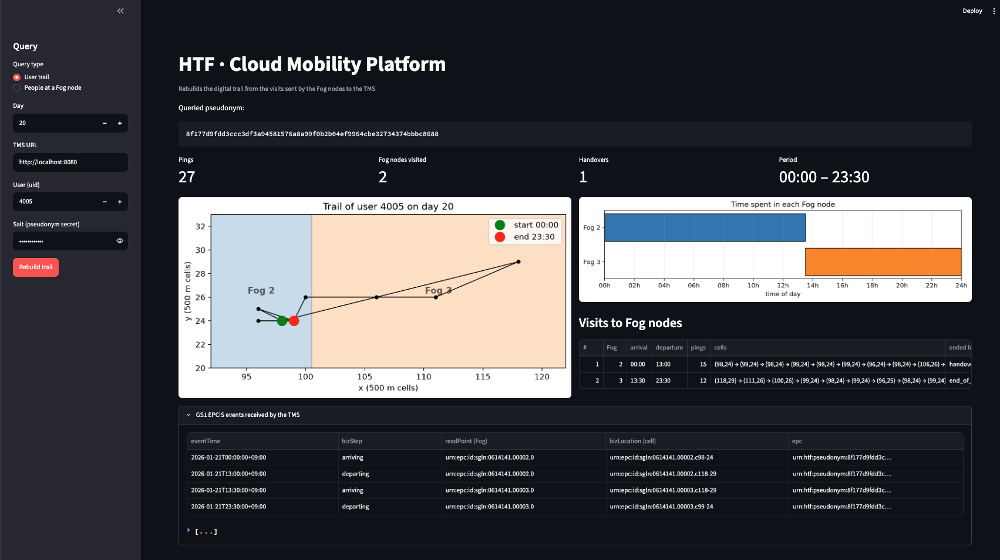
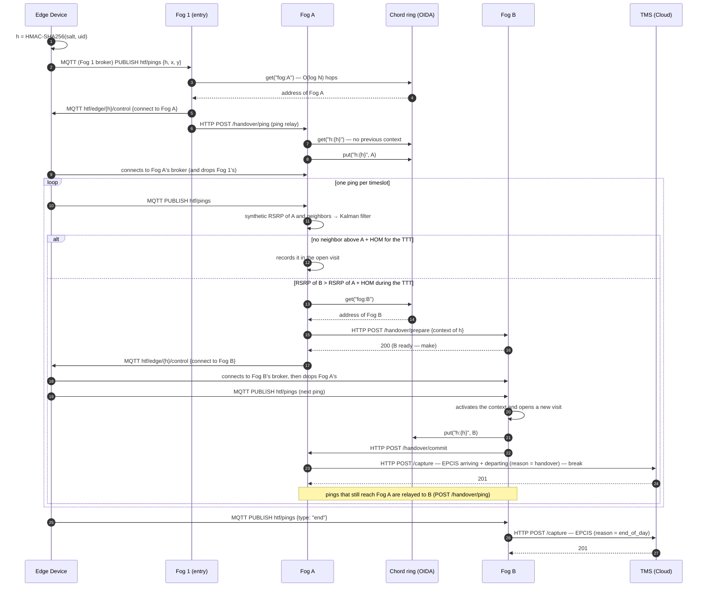
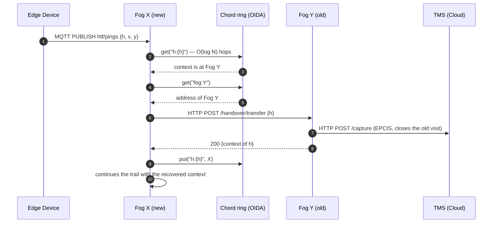
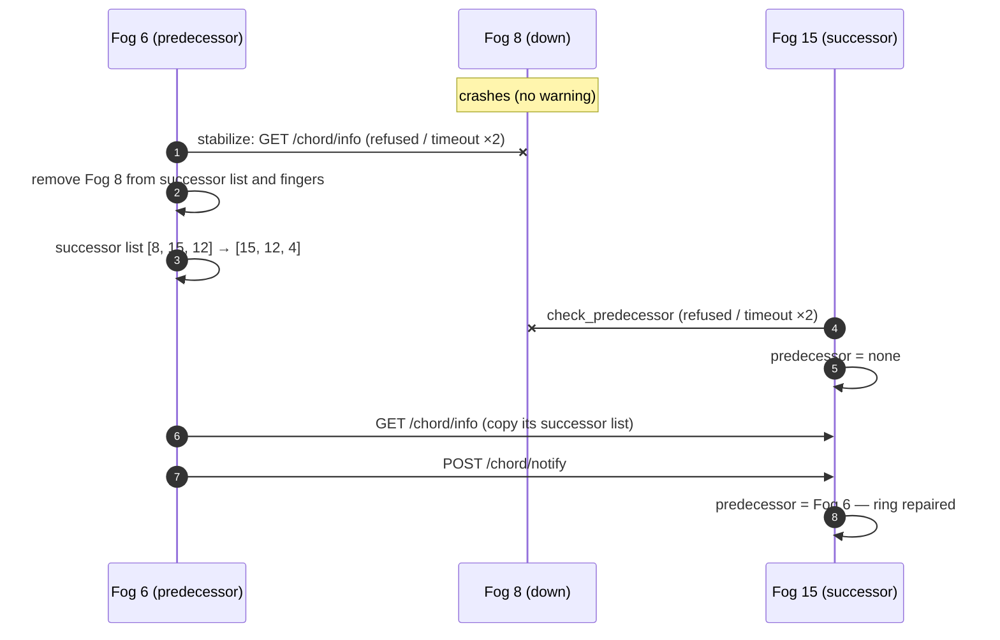
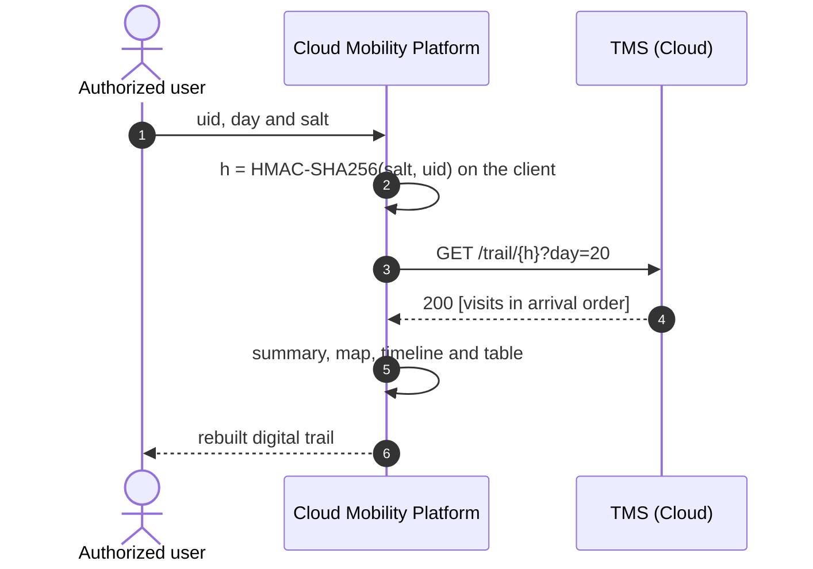
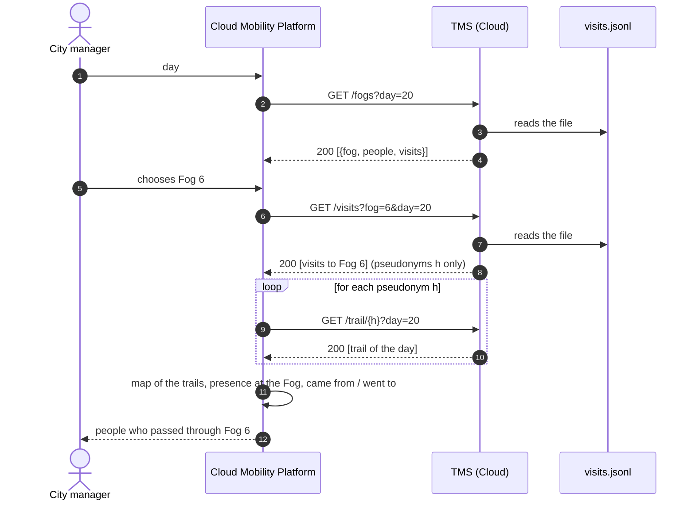

# HTF — Human Trail in the Fog

Rebuilding a person's digital trail through the Fog nodes of a smart city.
The Edge layer is simulated with the **YJMob100K** dataset (dataset 2):
anonymized trajectories on a grid of 200 × 200 cells of 500 m, in
30-minute timeslots.

Undergraduate thesis (TCC) — Computer Science, UNISINOS (2026) · João Vítor Accorsi · Advisor: Dr. Rodrigo da Rosa Righi


<sub>Cloud Mobility Platform, "User trail" query: user 4005 on day 20 (RSRP + Kalman + TTT handover policy). The user visits Fog 2 and Fog 3 with a single handover at 13:30; the expander at the bottom lists the GS1 EPCIS events (arriving/departing) received by the TMS.</sub>

---

## Architecture

```
                    ┌──────────── Fog 8 ────────────┐          ┌──────────── Fog 4 ────────────┐
Edge ──MQTT :1908──►│ embedded MQTT broker │ Fog    │◄──HTTP──►│ Fog    │ embedded MQTT broker │
     (switches      │                      │ node   │  direct  │ node   │                      │
      broker on     └──────────────────────┴───┬────┘  (P2P)   └───┬────┴──────────────────────┘
      handover)                                │   Chord ring (OIDA) among the 16 Fog nodes
                                               │
                                               └──HTTP POST /capture (GS1 EPCIS 2.0) :8080──► TMS (Cloud) ◄──HTTP GET── Mobility Platform :8501
```

- **Edge → Fog: MQTT, with a broker in each Fog node.** Each Fog node has its own embedded
  broker. The Edge connects to the broker of the Fog serving it, like a phone to its base
  station, and switches broker when the Fog tells it to (handover).
- **Fog ↔ Fog: direct (P2P) communication over a Chord ring.** The Fog nodes form a Chord ring
  (the paper's OIDA Resolver) to discover addresses and to locate a user's context by
  pseudonym, in O(log N) hops. The context goes straight from one Fog to the other over HTTP,
  with no intermediary. The ring repairs itself when a Fog node goes down (successor list,
  failure detection by timeout and predecessor check — see [Fog node failure](#fog-node-failure)).
- **Fog → Cloud: HTTP POST with store-and-forward** to the TMS.

| Layer | Service | Language | Folder | Role |
|---|---|---|---|---|
| Edge | Edge Device | Java | `edge/` | Reads the user/day from the dataset, publishes one ping per timeslot and switches broker when the Fog says so |
| Fog | 16 Fog nodes | Java | `fog/` | Each node: embedded MQTT broker, HTTP API, Chord ring peer and handover logic |
| Cloud | TMS — Trail Management Service | Java | `cloud/tms/` | Stores the visits and answers trail queries |
| Cloud | CMP — Cloud Mobility Platform | Python (Streamlit) | `cloud/mobility-platform/` | Web interface: rebuilds trails and shows the charts |

The city (200 × 200 cells) is split into **16 Fog nodes** of 50 × 50 cells (25 × 25 km).
Node N covers the area at row `(N-1) / 4` and column `(N-1) % 4` of the grid.

A **visit** is a user's stay in one Fog node's area: arrival, departure, cells, number of pings
and how it ended (handover to another Fog, or end of day). A user's **trail** is the ordered
list of visits in a day.

### Ports

| Port | Service | Use |
|---|---|---|
| **1901 – 1916** | Embedded MQTT broker of Fog node N (1900 + N) | Edge ↔ Fog |
| **9001 – 9016** | HTTP API of Fog node N (9000 + N) | Fog ↔ Fog (Chord ring and handover) |
| **8080** | TMS (Cloud) | Visits and trails |
| **8501** | CMP (Cloud) | Web interface — `http://localhost:8501` |

The Edge always enters through **Fog 1** (broker `tcp://localhost:1901`), which forwards it to the right Fog.

### MQTT topics (on each Fog's broker)

| Topic | From → To | Content |
|---|---|---|
| `htf/pings` | Edge → Fog | One ping per timeslot `{h, day, t, time, x, y, seq}`; at the end of the day, `{type: "end"}` |
| `htf/edge/{h}/control` | Fog → Edge | Handover command: `{type: "handover", fog: 4, broker: "tcp://localhost:1904"}` |

### HTTP API of each Fog node (port 9000 + N)

| Method | Endpoint | Purpose |
|---|---|---|
| `GET` | `/chord/info` | Node, successor and predecessor on the ring |
| `POST` | `/chord/closest` | One lookup step: closest node to the key in the finger table |
| `POST` | `/chord/notify` | "May I be your predecessor?" (ring stabilization) |
| `POST` | `/dht/put` · `GET /dht/get?key=` · `POST /dht/bulk` | Store, read and migrate ring records |
| `POST` | `/handover/prepare` | Fog A hands the user's context to Fog B (before the user arrives) |
| `POST` | `/handover/ping` | Relay of a ping that still reached the old Fog (or the entry node) |
| `POST` | `/handover/commit` | Fog B reports that the user arrived; Fog A closes its visit |
| `POST` | `/handover/transfer` | A new Fog asks for the context of a user who reappeared there |
| `GET` | `/status` | Node and ring state: successor list, predecessor, finger table (useful for debugging) |
| `POST` | `/admin/crash` | Simulates a crash of the node (stops its broker, API and timers without warning anyone) |

Records on the Chord ring: `fog:{id}` → node address; `h:{pseudonym}` → Fog node holding the user's context.

### TMS HTTP API (port 8080)

| Method | Endpoint | Called by | Purpose |
|---|---|---|---|
| `POST` | `/capture` | Fog | Receives a visit as a GS1 EPCIS 2.0 document (201 = new, 200 = repeated, 400 = invalid) |
| `GET` | `/events/{h}?day=20` | CMP | EPCIS events (arriving/departing) of pseudonym `h` on the day, in time order |
| `GET` | `/trail/{h}?day=20` | CMP | Returns the person's trail (visits of pseudonym `h` on the day, in order) |
| `GET` | `/visits?fog=6&day=20` | CMP | Visits recorded by Fog 6 on day 20 (who passed through it) |
| `GET` | `/fogs?day=20` | CMP | Fog nodes with visits on the day: `[{fog, people, visits}]` |
| `GET` | `/health` | anyone | Checks whether the TMS is up |

The TMS keeps each EPCIS document as received in `cloud/tms/data/epcis.jsonl` (event repository)
and the visit derived from it in `cloud/tms/data/visits.jsonl` (used by the trail queries). Every
query reads these files, so data from previous runs shows up without restarting the TMS (and
deleting them clears the queries right away).

### Handover decision (RSRP + Kalman + TTT)

YJMob100K has no radio measurements, so the serving Fog generates a **synthetic RSRP** for itself
and for its neighbors on every ping, with the log-distance path loss model
`RSRP = P0 − 10·n·log10(d/d0) + X_σ`, where `d` is the distance from the user's cell to the center
of each Fog's area. Each Fog's RSRP goes through a **Kalman filter** (its state is part of the user
context and migrates with the user). The handover to neighbor B is triggered only when
`RSRP_B > RSRP_serving + HOM` holds for the **Time to Trigger (TTT)**; this removes the ping-pong
effect near area borders.

| Parameter | Value | Where |
|---|---|---|
| P0 (at d0 = 0.5 km, one cell) | −40 dBm | `fog/Config.java` |
| Path loss exponent n | 3.5 | `fog/Config.java` |
| Shadowing σ | 4 dB (seeded by pseudonym, ping and Fog: runs are reproducible) | `fog/Config.java` |
| Kalman Q / R | 1.0 / σ² | `fog/Config.java` |
| HOM (hysteresis) | 3 dB | env `HTF_HOM_DB` |
| TTT | 60 min of dataset time (2 pings) | env `HTF_TTT_MIN` |
| Policy | `rsrp` (default) or `area` (handover as soon as the user leaves the area: baseline) | env `HTF_HANDOVER` |

To compare with the baseline, start the Fog with `HTF_HANDOVER=area mvn -q compile exec:exec`.

### GS1 EPCIS 2.0 events

When a visit closes (handover or end of day), the Fog sends it to the TMS as an EPCIS 2.0 document
(JSON-LD) with two `ObjectEvent`s:

| EPCIS field | arriving | departing |
|---|---|---|
| `eventTime` | arrival (day 0 = 2026-01-01, offset +09:00) | departure |
| `epcList` (what) | `urn:htf:pseudonym:{h}` (the real id never leaves the Edge) | same |
| `readPoint` (where: Fog) | `urn:epc:id:sgln:0614141.{fog:05}.0` | same |
| `bizLocation` (where: cell) | `urn:epc:id:sgln:0614141.{fog:05}.c{x}-{y}` (first cell) | last cell |
| `bizStep` (why) | `arriving` | `departing` |
| `action` | `OBSERVE` | `OBSERVE` |
| `htf:*` extensions | day, slot, fogSize | + arrivalSlot, cells, pings, reason, nextFog |

`0614141` is the example GS1 Company Prefix used in the GS1 standards. The CMP shows the events of a
trail in the expander **GS1 EPCIS events received by the TMS**, and they can be read with
`curl 'localhost:8080/events/{h}?day=20'`.

### Privacy

The dataset `uid` never leaves the Edge: only the pseudonym `h = HMAC-SHA256(salt, uid)` travels.
Fogs, the Chord ring and the TMS store only `h` ("blind" cloud). The CMP receives the uid of the
authorized user, computes `h` locally with the same salt and only then queries the TMS.

In the **People at a Fog node** query the CMP uses neither uid nor salt: it only sees pseudonyms
(city manager view). Even so, a full-day trail may re-identify someone (home/work), a point to
discuss in the privacy model.

---

## How to run

### Prerequisites (once)

| Tool | Check | Install (macOS, Apple Silicon) |
|---|---|---|
| JDK 17+ | `java -version` | `brew install openjdk@21` |
| Maven | `mvn -v` | `brew install maven` |
| Python 3.11+ | `python3 --version` | python.org or `brew install python` |

There is no need to install or start Mosquitto: each Fog node ships its own embedded broker.

CMP Python environment, **outside iCloud** (inside iCloud Drive Python becomes very slow):

```bash
python3 -m venv ~/.venvs/htf
source ~/.venvs/htf/bin/activate
pip install -r cloud/mobility-platform/requirements.txt
```

The dataset must be at `YJMob100K/yjmob100k-dataset2.csv`. If the project is in
iCloud, mark the `YJMob100K` folder as **"Keep Downloaded"** in Finder.

### Step by step

All commands start from the project root. Use one terminal per service, **in this order**.

**1. TMS (Cloud)**

```bash
cd cloud/tms && mvn -q compile exec:exec
```
Wait for: `[TMS] listening on http://localhost:8080`.

**2. Fog — the 16 nodes** (keep it running)

```bash
cd fog && mvn -q compile exec:exec
```
Each node starts its broker and its API, joins the Chord ring through Fog 1 and the ring stabilizes.
Wait (≈ 5–10 s) for:
```
[Fog   ] Chord ring ready with 16 nodes (ring order: [1, 10, 6, 8, ...])
[Fog   ] you can run the Edge now.
```

**3. Edge** (publishes the user/day and exits)

```bash
cd edge && mvn -q compile exec:exec
```

The Fog terminal shows the entry through Fog 1, the ring lookups (`OIDA: ... (3 hops)`),
the handovers (`PREPARE`, `COMMIT`) and the visits sent to the TMS. The Edge terminal shows the
commands received and the broker switches (`HANDOVER: now connected to Fog 4`).

**4. Cloud Mobility Platform**

```bash
source ~/.venvs/htf/bin/activate
cd cloud/mobility-platform && streamlit run mobility_platform.py
```
Opens at **http://localhost:8501**. In the sidebar, choose the query type:

- **User trail**: enter the user (uid) and day and click **Rebuild trail**.
- **People at a Fog node**: enter the day, choose the Fog (the list only shows Fogs with
  visits on that day and how many people passed through each one) and click **Query Fog node**.
  It shows the map with each person's trail (queried Fog highlighted), the timeline of presence
  at the Fog and the table of visits with where each person came from and where they went.

> Always use `mvn -q compile exec:exec` (not `exec:java`). The Fog must be running
> (ring ready) before the Edge.

### Expected result (user 4000, day 20)

13 pings · 2 Fog nodes (8 and 4) · **1 handover** · 08:30–18:00. The user moves along the border
between Fogs 8 and 4 (y = 50). With the RSRP policy the handover happens once, after the condition
held for the TTT; with `HTF_HANDOVER=area` the same user makes **4 handovers** back and forth
(ping-pong effect).

```
[Fog  1] user 0fe28881... outside my area -> redirected to Fog 8
[Fog  8] ping 09:00 | cell (181,51) | RSRP Fog 8 -96.2 dBm, best neighbor Fog 4 -91.1 dBm | > HOM for 30/60 min
[Fog  8] ping 09:30 | cell (174,49) | RSRP Fog 8 -94.0 dBm, best neighbor Fog 4 -91.3 dBm
[Fog  8] ping 10:00 | cell (165,45) | RSRP Fog 8 -94.3 dBm, best neighbor Fog 4 -88.6 dBm | > HOM for 30/60 min
[Fog  8] ping 10:30 | cell (165,45) | RSRP Fog 8 -93.6 dBm, best neighbor Fog 4 -88.9 dBm | > HOM for 60/60 min -> HANDOVER to Fog 4
[Fog  4] PREPARE received from Fog 8 for user 0fe28881...
[Fog  4] user 0fe28881... arrived; taking over (handover #1, from Fog 8)
[Fog  8] COMMIT from Fog 4: handover complete; visit 08:30-10:00 -> TMS
[TMS ] POST /capture (EPCIS) Fog 8 08:30-10:00 -> HTTP 201
```

### One Fog node per process (as in containers)

By default the 16 nodes start in the same process, but they share nothing: they only talk over the network.
To start separate nodes, use `HTF_FOG_IDS` (Fog 1 is the ring seed and must start first):

```bash
cd fog && HTF_FOG_IDS=1 mvn -q compile exec:exec        # terminal A
cd fog && HTF_FOG_IDS=2-16 mvn -q compile exec:exec     # terminal B (or one per node: HTF_FOG_IDS=8)
```

In containers, `HTF_FOG_HOST` sets the host name advertised by the node and `HTF_FOG_SEED`
the URL of Fog 1 (default `http://localhost:9001`).

### Fog node failure

The Chord ring follows the full Chord protocol (Stoica et al., 2001), so it repairs itself when a Fog node goes down:

- **Successor list:** each node keeps its next 3 nodes on the ring (`SUCCESSOR_LIST_SIZE`), copied
  from its successor every 500 ms. If the successor goes down, the next one in the list takes its place,
  so the ring survives up to 2 consecutive nodes failing at once.
- **Failure detection:** a node is considered down when its port refuses the connection, or when it
  does not answer within 1.5 s twice in a row (`FAILURE_TIMEOUT_MS`). It is removed from the successor
  list and the finger table, and lookups that hit it start again around it.
- **Predecessor check:** every 500 ms each node pings its predecessor; if it is down, it is cleared and
  the next node that notifies becomes the new predecessor.
- **Stale addresses:** every Fog republishes its `fog:{id}` record every 3 s; a record not refreshed for
  10 s (`ADDRESS_TTL_MS`) is treated as a Fog that is down, so no one keeps sending users to it.

To see it, with the Fog running, crash one node (Fog 8 sits between Fog 6 and Fog 15 on the ring):

```bash
curl -X POST localhost:9008/admin/crash
```

```
[Fog  8] SIMULATED CRASH: broker, HTTP API and timers stopped without telling anyone
[Fog  6] Chord: successor Fog 8 is down -> new successor Fog 15
[Fog 15] Chord: predecessor Fog 8 is down -> waiting for a new one to notify
[Fog 15] Chord: new predecessor Fog 6 (ring repaired)
```

`curl localhost:9006/status` then shows Fog 6 with the successor list `[15, 12, 4]`.

What this version does **not** recover yet: records stored only on the failed node (the `h:{pseudonym}`
entries it held; there is no replication), the contexts and open visits that were in its memory, and the
Edge connected to its broker (the Edge does not reconnect elsewhere). Visits already sent to the TMS are safe.
If Fog 1 (the seed) goes down, the ring keeps working, but new nodes and new Edges cannot enter through it.

### Another user or day

Change `USER` and `DAY` in `edge/src/main/java/edge/Config.java` and run only step 3 again
(TMS and Fog keep running). In the CMP, query the new user/day.

### Stopping

`Ctrl+C` in the TMS, Fog and CMP terminals. The data is kept in `cloud/tms/data/epcis.jsonl`
and `cloud/tms/data/visits.jsonl`; delete both files to start from scratch.

### Useful tools

```bash
curl localhost:9008/status                   # state of Fog 8 on the ring (successor list, predecessor, finger table)
curl -X POST localhost:9008/admin/crash      # simulate Fog 8 going down (see "Fog node failure")
curl localhost:8080/health                   # is the TMS up?
curl 'localhost:8080/fogs?day=20'            # Fogs with visits on day 20
curl 'localhost:8080/visits?fog=6&day=20'    # who passed through Fog 6 on day 20
curl "localhost:8080/events/$H?day=20"        # EPCIS events of pseudonym $H on day 20
mosquitto_sub -p 1908 -t 'htf/#' -v          # messages on Fog 8's broker (requires Mosquitto installed)
lsof -i :9001                                # who is using Fog 1's port
```

## Sequence diagrams (section 4.3 of the paper)

### Entry, make-before-break handover and sending to the TMS

The Fog decides the handover and commands the Edge; the target Fog receives the context before
the user arrives (make-before-break); the context goes directly between the Fogs (P2P).



### User reappears in another Fog (locating the context through the ring)

When a Fog receives a user without a handover having happened (e.g. they were offline for
hours), it looks up on the Chord ring who holds their context and pulls it directly.



### Fog node failure and ring repair



### Rebuilding a user's trail in the Cloud



### Query by Fog node (who passed through it)

